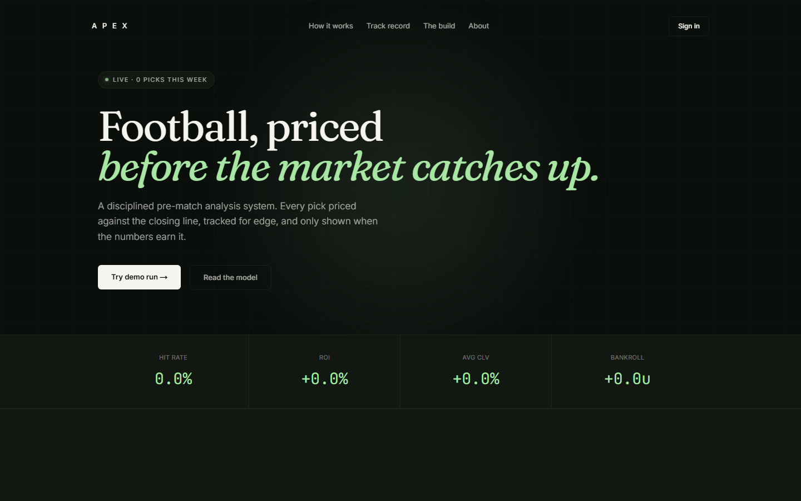

<div align="center">

# APEX

**Football, priced before the market catches up.**

[Live demo](https://apex-ai-analysis.vercel.app)

</div>



Pre-match football analysis with the discipline of a value-betting model. Built as a personal
project to test whether a strict edge-based system can beat the closing line.

## What it does

Once a week, APEX scans the coming 7 days of fixtures across 10 leagues. For each match, it
fetches structured data (form, goals rate as an xG proxy, standings, lineups, odds) and uses
Claude Sonnet 5 for the qualitative read and the break-the-pick step. Everything else - triage,
Poisson goals math, penalty stacking, the VALUE GATE, staking, and settlement - is deterministic
code. The model only touches judgment.

## Why the VALUE GATE matters

Most public betting content chases high probability. That reads well but loses money against
the vig. APEX only produces a pick when its probability beats the de-vigged market implied
probability by a minimum edge. No edge, no pick. Empty weeks are correct outcomes when the
market is efficient.

## Guest mode, not guest runs

A live run calls Claude Sonnet 5 against real fixtures and costs real money - roughly $0.25 per
run. If this link gets shared and a few hundred people click "Run analysis," that's an
open-ended bill for zero benefit, since a reviewer only needs to see what the system produces,
not personally pay for the compute. So:

- Anyone can sign up. Every new account is a `guest` by default.
- Guests see a real, pre-computed sample run on `/run`, and the same shared, public
  `global_track_record` everyone else sees on `/tracking` and the homepage.
- One hardcoded `ADMIN_EMAIL` account can trigger real runs. The button is server-gated in
  `/api/run`, not just hidden in the UI - a guest calling the endpoint directly still gets a 403.
- The admin's real, settled picks are the only thing that ever writes to
  `global_track_record`. Every account reads the same rows.

## Stack

- Next.js (App Router) + TypeScript
- Supabase (Postgres + Auth + RLS)
- Anthropic Claude Sonnet 5 (with prompt caching + Message Batches)
- Deterministic TypeScript for the pipeline math
- Data from API-Football and football-data.org (both keys required)
- Framer Motion for the interface's motion system, Recharts for the track-record chart
- Deployed on Vercel

## Cost profile

A live run costs roughly $0.25. Real runs are restricted to one admin account, so visitor traffic can't move that number.

## Local development

```bash
npm install
cp .env.example .env.local   # fill in Supabase, Anthropic, and provider keys
npm run dev
```

Environment variables needed:

| Variable | Purpose |
| --- | --- |
| `ANTHROPIC_API_KEY` | Claude Sonnet 5 calls |
| `API_FOOTBALL_KEY` | API-Football (fixtures, lineups, odds) - a direct key from dashboard.api-football.com, not RapidAPI |
| `FOOTBALL_DATA_ORG_KEY` | football-data.org (standings, form) |
| `NEXT_PUBLIC_SUPABASE_URL`, `NEXT_PUBLIC_SUPABASE_ANON_KEY` | Client-side Supabase |
| `SUPABASE_SERVICE_KEY` | Server-only admin client (settlement cron, run persistence) |
| `ADMIN_EMAIL` | The one account allowed to trigger real runs |
| `CRON_SECRET` | Authenticates Vercel's daily settlement cron hit |
| `ODDS_API_KEY` | Optional odds fallback |
| `ANTHROPIC_MODEL_DEFAULT`, `ANTHROPIC_MODEL_ESCALATION` | Optional model overrides |

## Author

Rydny - Computer Science, University of Latvia. Built in Riga, 2026.
